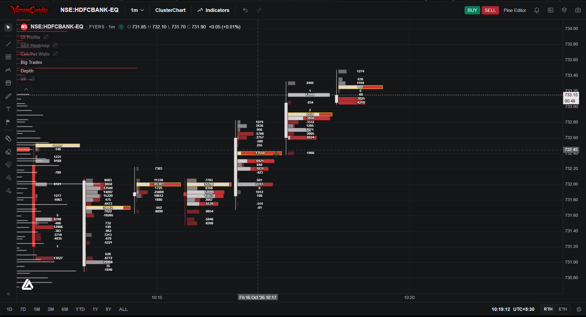
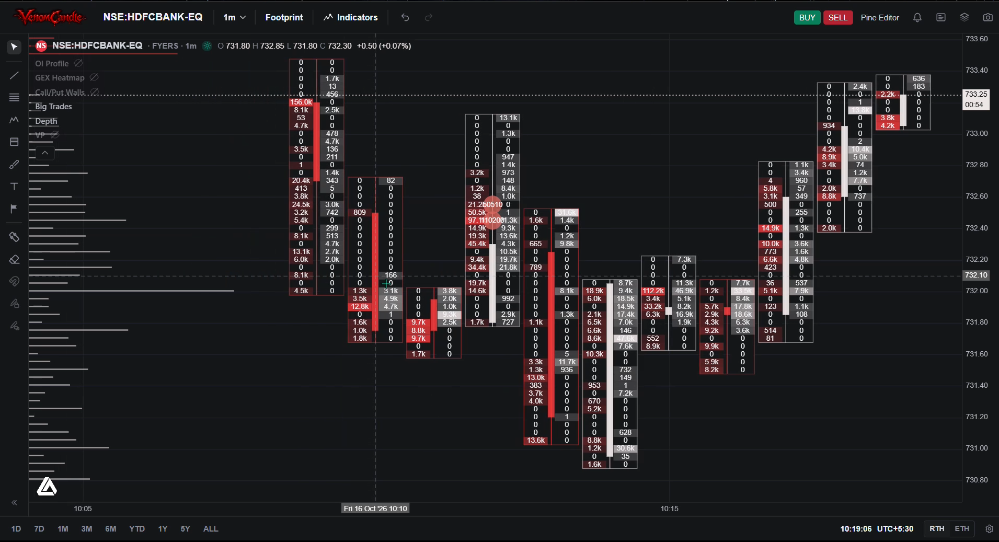
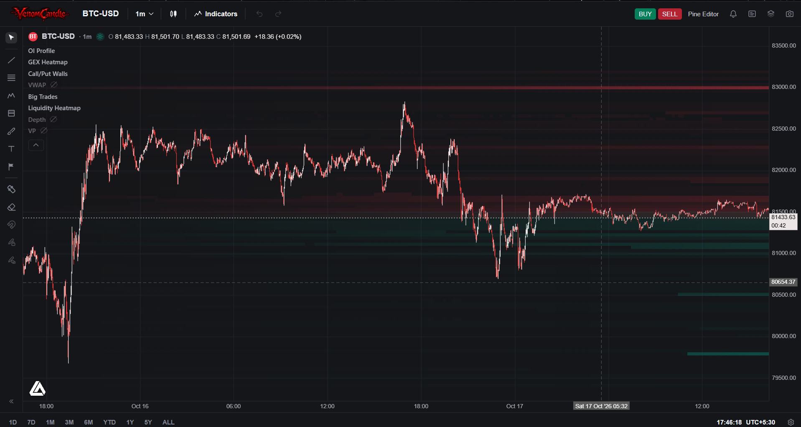
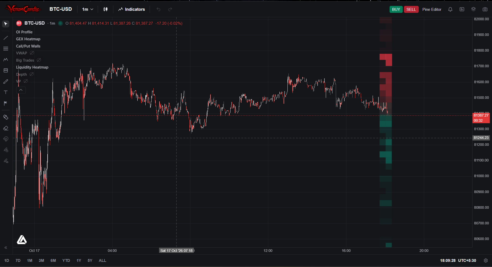

# VenomCandle

A high-performance, real-time trading engine for Indian and global markets, built in C++17. VenomCandle streams live tick data directly from your broker, classifies every trade as an aggressive buy or sell, and renders professional-grade charting tools in your browser — no Python runtime, no Electron, no paid data vendor.

Everything runs as a single native executable. You point it at your broker, open `localhost:8080`, and your chart is live in seconds.

---

## What it looks like

**Cluster Chart — Footprint candles with buy/sell volume per price level**



**Footprint — Full bid/ask volume breakdown inside every candle**



**Liquidity Heatmap — Historical order book depth across time**





---

## What it does

**Real-time tick feed**
VenomCandle connects directly to your broker's WebSocket feed and processes every trade tick as it arrives. No polling. No batching delays. Ticks flow straight into the engine at wire speed.

**Aggressive buy/sell classification**
Every trade is classified as an aggressive buy (hit the ask), aggressive sell (hit the bid), or neutral using a Lee-Ready tick-test fallback for trades inside the spread. This is the foundation of every volume tool in the chart.

**Volume Profile**
A cache-friendly, fixed-point volume profile engine runs on every tick. Point of Control, Value Area High, and Value Area Low update in real time. The session VP broadcasts only the changed levels to the browser — not the full dataset — keeping the feed lean even on high-volume instruments.

**Footprint / Cluster Charts**
Each 1-minute candle shows the buy and sell volume transacted at each price level inside that candle. You see exactly where orders were absorbed and where imbalances formed.

**50-Level Limit Order Book**
A live depth feed shows all 50 bid and ask levels with quantity and order count. The book updates tick by tick, not on a snapshot timer.

**Liquidity Heatmap**
Historical order book depth rendered as a heatmap across time. Identify where liquidity has consistently been offered and where it has been swept.

**Gamma Exposure (GEX)**
For supported instruments, VenomCandle fetches the full options chain, computes gamma exposure for every strike across all expiries, and broadcasts the Call Wall and Put Wall to the chart. Refreshes every 5 minutes automatically and on demand.

**Fixed Range Volume Profile**
Select any range of candles on the chart and instantly compute the volume profile for that specific window.

**Symbol switching**
Subscribe to any symbol during the session without restarting. Historical candles are fetched in the background and the volume profile starts building from the first live tick.

---

## Broker support

VenomCandle currently supports two brokers out of the box:

**Fyers**
Full support for NSE, BSE, and MCX instruments. Live tick feed via the Fyers Data WebSocket (protobuf). Historical 1-minute candles via the Fyers History REST API. 50-level tick-by-tick depth via the Fyers TBT WebSocket. Options chain GEX via the Fyers Options Chain API. Supports equities, indices, futures, and options.

**Coinbase**
Full support for Coinbase spot market instruments (BTC-USD, ETH-USD, etc.). Live ticker, trades, and level-2 depth via the Coinbase Advanced Trade WebSocket. Historical candles via the Coinbase Exchange REST API. No API key required for public market data.

---

## Roadmap — Indian broker support

The broker layer is fully abstracted. Adding a new broker requires creating one adapter directory with three to five files — the engine core is never touched. The roadmap targets all major Indian retail brokers:

- Zerodha (Kite Connect WebSocket)
- Upstox (Market Data WebSocket v3)
- Angel One (SmartAPI WebSocket)
- ICICI Breeze
- Shoonya (Finvasia)
- Dhan
- Motilal Oswal (MO Trader API)

Each of these brokers will map onto the same tick contract that drives the volume profile, footprint, and heatmap — so every tool works identically regardless of which broker you are connected to.

If you want to add your broker today, see `docs/ADDING_A_BROKER.md` for the complete integration guide.

---

## Building from source

**Requirements**

- Windows 10 or later (uses WinHTTP and Winsock2)
- CMake 3.15 or later
- A C++17 compiler (MinGW-w64 / MSYS2 or MSVC)
- Protocol Buffers (libprotobuf)
- libwebsockets
- pkg-config (for MinGW builds)

**Install dependencies with MSYS2 (recommended)**

```bash
pacman -S mingw-w64-x86_64-cmake
pacman -S mingw-w64-x86_64-protobuf
pacman -S mingw-w64-x86_64-libwebsockets
pacman -S mingw-w64-x86_64-pkg-config
```

**Select your broker**

Open `include/config.h` and set the broker:

```cpp
// For Fyers (Indian markets — NSE, BSE, MCX):
#define TRADING_BROKER_NAME "FYERS"

// For Coinbase (crypto spot markets):
#define TRADING_BROKER_NAME "COINBASE"
```

If you are using Fyers, also set your credentials in `include/broker_adapters/fyers/config.h`:

```cpp
inline std::string fyersAppId()      { return "YOUR_APP_ID"; }
inline std::string fyersAccessToken(){ return "YOUR_ACCESS_TOKEN"; }
```

**Configure and build**

```bash
# From the project root, create a build directory:
mkdir build && cd build

# Configure (MinGW):
cmake -G "MinGW Makefiles" -DCMAKE_BUILD_TYPE=Release ..

# Build:
cmake --build . --config Release
```

CMake reads `TRADING_BROKER_NAME` from `config.h` automatically and compiles only the relevant adapter and protobuf schema. You do not need to pass any CMake variables manually.

**Run**

```bash
./TradingEngine.exe
```

Open your browser at `http://localhost:8080`. The chart loads immediately with historical candles from the last 5 sessions and begins streaming live ticks.

---

## Architecture in brief

The engine is split into three layers so that broker integrations never touch chart or server logic:

```
Engine Core  (main.cpp, server.cpp, tick_processor.cpp, volume_profile.cpp)
     |
     |  calls stable broker-neutral functions from include/broker/
     v
Dispatch Shims  (src/broker/*.cpp)
     |
     |  routes to the broker selected in config.h
     v
Broker Adapter  (src/broker_adapters/<name>/*.cpp)
```

The chart data pipeline:

```
Broker WebSocket
      |
      v
data_live.cpp  ->  Tick{}
                      |
                      v
              tick_processor.cpp
              /                 \
             v                   v
        FlowPacket         VolumeProfileEngine
             |                   |
             v                   v
     broadcast("flow")    broadcast("vp")
             |
             v
          Browser  (frontend.html + app.js + Vela chart)
```

---

## Project layout

```
VenomCandle/
  include/              Shared headers (config, types, broker facades)
    broker/             Broker-neutral interface headers
    broker_adapters/    Per-broker implementation headers
    core/               Utilities (json_parser.h)
  src/
    broker/             Compile-time dispatch shims
    broker_adapters/    Per-broker implementations
  proto/
    broker_schemas/     Protobuf wire-format schemas
  frontend.html         Browser chart UI
  app.js                Chart logic, WebSocket client, all overlays
  docs/
    README.md           This file
    ADDING_A_BROKER.md  Guide to integrating a new broker
```

---

## Documentation

- `docs/README.md` — this file (project overview, build instructions, roadmap)
- `docs/ADDING_A_BROKER.md` — complete step-by-step guide for integrating a new broker with annotated code templates, contracts, and a common-mistakes table

---

## License

See `LICENSE` for terms.
